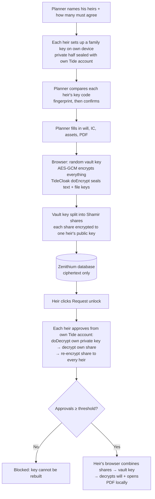

# Zenithium: study guide for presenters

Read this in 10 minutes and you can explain Zenithium to judges in 5. No Next.js or TideCloak knowledge needed.

## 1. What TideCloak is (in 3 sentences)

TideCloak is a login and access system (built on the popular Keycloak) where **the keys that protect your data are not held by the app company**. Instead, they're split across Tide's decentralised network and bound to each user's own Tide account. An app can ask TideCloak to encrypt (`doEncrypt`) or decrypt (`doDecrypt`) data for the logged-in user, but the app itself never holds a master key that could open everyone's data.

**How that differs from normal encryption:** in a normal app, "encrypted" usually means the *company* encrypts your data with a key it stores on its own servers. So the company, a rogue employee, or a hacker who breaks in can decrypt everything. With TideCloak, **there is no company-held key to steal**.

## 2. The 3 trust constraints and where they're enforced

| Constraint | What it means | Where in the code |
|---|---|---|
| **1. Admin can't read** | Zenithium's server and database only ever see ciphertext | `app/app/seal/page.jsx` → `seal()` encrypts everything **before** the `POST`. `app/app/api/vault/route.js` → `POST` stores what it receives (already ciphertext). `app/lib/store.js` → `writeDb()` writes `data/db.json`. `app/app/database/page.jsx` shows the raw file. |
| **2. No single heir can unlock** | It takes *threshold* heirs (2 of 2, chosen by the planner) to open the vault | Planner chooses heirs + threshold: `app/app/seal/page.jsx` → `nameHeirs()` → `app/app/api/plan/route.js`. Key check: `app/lib/crypto.js` → `keyFingerprint()`, and the planner must tick "codes match" for each heir before Seal is enabled. `app/lib/crypto.js` → `splitSecret()` / `combineShares()` (Shamir secret sharing: fewer shares = mathematically impossible). `app/app/vault/page.jsx` → `approve()` and `openVault()` (refuses below threshold). `app/app/api/unlock/route.js` → `POST` only accepts one approval per distinct, verified heir. |
| **3. Encrypted before it leaves your device** | Encryption happens in the browser | `app/app/seal/page.jsx` → `seal()` calls TideCloak `doEncrypt` (text fields and file keys) and `aesEncrypt` (files). `app/app/vault/page.jsx` → `setupKey()` seals each heir's private key with **their own** `doEncrypt`; `myPrivateKey()` unseals it with `doDecrypt`. |

**Identity on the server:** `app/lib/serverAuth.js` → `getUser()` verifies the TideCloak token with the official SDK (`verifyTideCloakToken`). Who you are comes from the verified token, not from anything the browser claims.

## 3. Flow diagram

The same flow in plain text: **name heirs → heirs set up keys → planner confirms key codes → seal → encrypt in browser → store ciphertext → request unlock → approvals (each heir releases their key piece) → threshold met → decrypt in the heir's browser.**

## 4. What is real and what is SIMULATED (be honest)

**Real:**
- TideCloak login (official template), with server-side token verification.
- TideCloak `doEncrypt` / `doDecrypt`.
- AES-GCM file encryption.
- Shamir key splitting.
- The fact that the database holds only ciphertext.

**If the red "OFFLINE DEMO MODE" banner is showing:** TideCloak's licensing server failed during our setup, so login and `doEncrypt`/`doDecrypt` are simulated in that run. Say so plainly: "Tide's network was down during the hackathon (its nodes reported 'not enough ORKs'), so our demo uses the offline fallback. The TideCloak integration is wired in, and you're welcome to run the online version from our repo: it switches on automatically once the realm is set up." Bonus point to make: *even Tide's own network needs a quorum of nodes to agree, which is the same idea Zenithium applies to families.*

**Simulated** (details in `MOCKED.md`):
- **The quorum approval workflow ("SIMULATED QUORUM").** TideCloak's built-in quorum (change requests) approves *admin changes like role assignments*. TideCloak decryption is *self-only*: a user can decrypt only what they encrypted, so granting heirs a role can't open the planner's data. So *Zenithium* runs the approval steps. The vault key is still never held by Zenithium; it's split between the heirs.
- **Death verification:** none. Any heir can request an unlock.
- **Heir public keys:** trusted as served by Zenithium, not independently verified.
- **Storage:** a local JSON file instead of a real database.
- **Roles:** a username list as a fallback for realm roles.

## 5. Likely judge questions (short answers)

| Question | Answer |
|---|---|
| **What if the Zenithium server is hacked?** | The attacker gets the Database View: ciphertext. The vault key is never on the server; it's split between the heirs' devices, and each heir's private key is sealed by their own Tide account. |
| **How does the planner know the keys really belong to his children?** | Each heir's screen shows a short code (a fingerprint of their key). Mr Lim compares it with the code on his screen, in person or by phone, before he can seal, just like WhatsApp/Signal safety numbers. A server that swapped keys would show different codes. |
| **Who holds the keys?** | Nobody alone. Each heir's personal key is protected by TideCloak and bound to their own Tide account. The vault key exists only as shares held by the heirs, and is rebuilt only in an heir's browser after the quorum. |
| **What if one heir loses their account?** | With 2-of-2, the vault couldn't open, which is why the threshold is configurable. A real family would use e.g. 2-of-3 (adding a spouse or executor) so that losing one account doesn't lock the vault. Account recovery is handled by Tide, not by Zenithium. |
| **Why not just use normal password protection?** | A password-protected file still has *one* secret that one person (or the company storing it) can use or leak. Zenithium needs *several* family members to agree, and the company can't open it at all. |
| **Can Zenithium (the company) open the will?** | No. We never receive the vault key or any plaintext key share. We could refuse to process approvals (an availability risk), but we can't read the will. |
| **Can one greedy heir open it alone?** | No. One share reveals nothing; the maths needs *threshold* shares. In the demo, the son tries alone and is blocked. |
| **What's mocked?** | The approval workflow is run by our app (SIMULATED QUORUM), plus death verification and heir-key verification, and the storage is a JSON file. The encryption and TideCloak login are real. See MOCKED.md. |
| **Why TideCloak and not AWS KMS / Firebase?** | With KMS, the cloud provider and the app company hold the key, which brings back blind trust. TideCloak removes the central key holder, which is exactly the trust constraint of this challenge. |
| **Who is this for?** | Malaysian families after a death, especially widows and elderly spouses who are often excluded from the paperwork. It also helps reduce family disputes (SDG 16, 1, 5). |

## 6. 30-second elevator pitch (memorise this)

> "When a parent dies, their will and papers usually sit with one person or one company, and the family has to trust them blindly. That's where disputes and fraud start. **Zenithium** seals those documents in the browser using TideCloak, so **not even we can read them**. The key is split between the heirs, so **no single person can open the vault alone**. It opens only when the family agrees together, each from their own account. Our Database View proves it: an admin sees only ciphertext. Zenithium protects widows, elderly spouses and families in grief, without asking anyone for blind trust."
